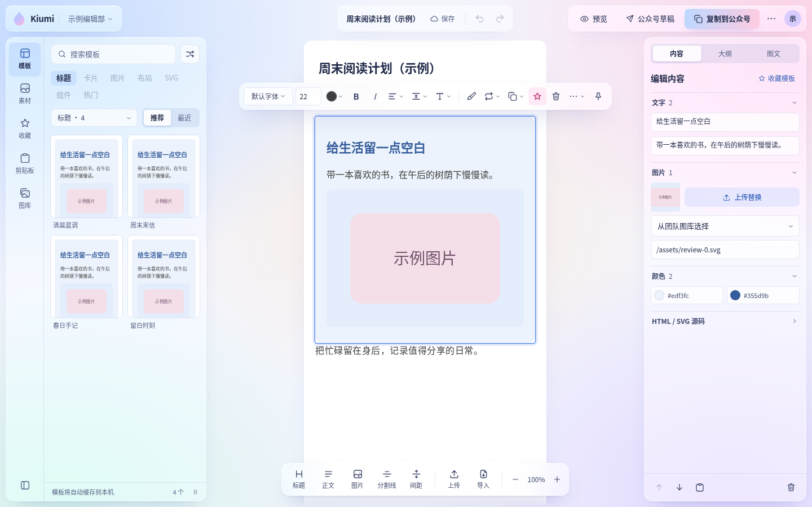
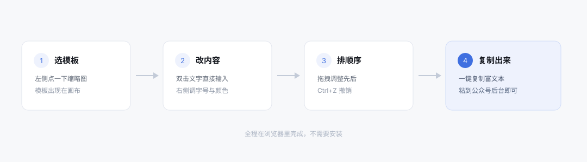
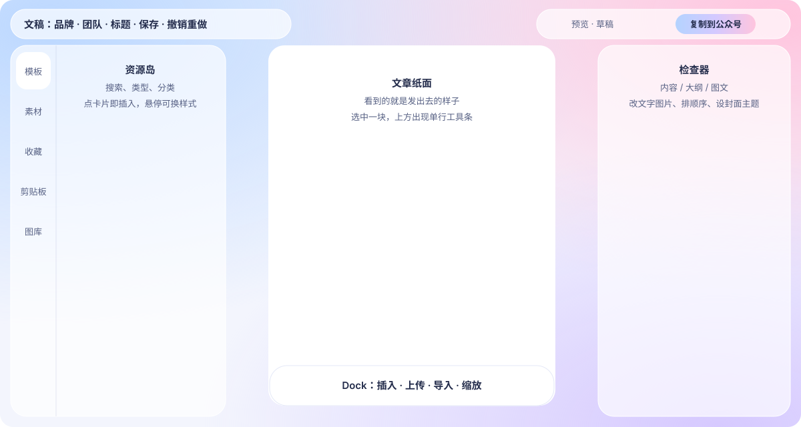

<div align="center">

# Kiumi

排版公众号图文：挑一个模板，在画布上改字换图，复制出来就能贴进公众号后台。

**[kiumi.plutokeating.beer](https://kiumi.plutokeating.beer)**

</div>



## 怎么用

1. 打开上面的网址。
2. 在左侧点一个模板缩略图，它会出现在中间的文稿里。
3. 选中已有内容块后，把鼠标移到模板卡片上点「换样式」，内容保留、外观更换；双击文字就能改，粘贴文字自动沿用模板字体和颜色；选中任意一块，上方工具条调字号和颜色，右侧「内容」改文字和图片。
4. 点「复制到公众号」，到公众号后台粘贴；也可登录后在「公众号草稿」选择团队公众号、封面，直接同步草稿。
5. 已有 Word/WPS `.docx`、富文本、Markdown 或网页内容，可用底部 Dock 的「导入」先预览，再分块追加、插入或新建文稿；图片 ZIP 可批量导入团队图库。带图导入需登录并选团队，图片总量上限 80 MB。



## 界面结构



| 位置 | 作用 |
|---|---|
| 左上胶囊 | 品牌与团队入口 |
| 顶部中间胶囊 | 当前文稿、保存、撤销与重做 |
| 右上胶囊 | 预览、公众号草稿、复制到公众号；「⋯」里新建和导出 HTML |
| 左侧资源岛 | 模板、素材、收藏、剪贴板、图库；点一下就用 |
| 中间纸面与底部 Dock | 你的文稿，看到的就是发出去的样子；Dock 在选中块之后插入内容、上传、导入、缩放 |
| 右侧检查器 | 「内容」改所选块，「大纲」排顺序，「图文」设封面、摘要、作者、标签、主题色并看发布前检查 |

## 常用操作

| 想做的事 | 怎么做 |
|---|---|
| 改文字 | 在画布上双击那段文字 |
| 换图片 | 选中那块，在右侧「内容」上传替换或填图片地址 |
| 调整顺序 | 在右侧「大纲」里拖动 |
| 换个颜色 | 在右侧「图文」点主题色，能换色的模板会一起变色 |
| 统一格式 | 选中一块按 `Ctrl+Alt+C` 取格式，再选另一块按 `Ctrl+Alt+V` |
| 撤销 | `Ctrl+Z` |
| 删除 | 选中后按 `Delete` |
| 换顺序 | 直接拖动块，或用悬停时块右上角的箭头 |
| 选中别的块 | `↑` `↓` 逐块移动，`Esc` 取消选中 |
| 插入空行 | 在画布上右键，或工具条「⋯」里选「前插空行」「后插空行」 |

登录后可创建或加入团队，在左上角团队入口里保存、打开稿件和邀请成员。文稿与图库在团队内共享、团队间隔离。未登录也能排版，文稿自动保留在本机。

## 模板和图片放在哪里

模板和图片保存在自己的数据服务里，由这台服务提供给网站。仓库里只有代码，没有模板和图片。

## 给开发者

```bash
pnpm install
pnpm dev        # 本地 API 与工作台
pnpm test
```

| 目录 | 内容 |
|---|---|
| `packages/core` | 排版引擎：把模板和数据变成最终 HTML |
| `packages/catalog` | 模板整理与素材同步 |
| `packages/sdk` | 给命令行、MCP、服务端共用的接口 |
| `packages/cli` | `kiumi` 命令行 |
| `packages/mcp` | 给 AI 客户端用的 MCP 服务 |
| `apps/edge` | Cloudflare Worker，同时提供网页与接口 |
| `apps/web` | 浏览器里的工作台 |
| `apps/server` | 本地服务，用于查看素材与推送草稿 |
| `deploy/ecs-data` | 数据服务，只读，提供给 Worker |

命令行常用的几条：

```bash
kiumi list --room <分类> --q <关键词>
kiumi render --tpl <模板编号> --set 'txt1=<p>标题</p>' -o out.html
kiumi validate out.html
kiumi audit
```

更细的说明在 [`docs/`](docs/)。

## 现在的状态

| 项 | 结果 |
|---|---|
| 模板 | 25,745 个可分页浏览（3,927 个经典模板 + 21,818 个新版模板） |
| 渲染 | 有骨架的按组件拼装，缺骨架的回放模板原始结构，0 失败 |
| 素材 | 9,508 个引用，7,306 个已放到本地；剩下 2,201 个在原站就取不到，页面回落到占位图 |
| 登录 | 用现有账号体系登录，文稿按账号分开保存 |
| 测试 | 核心/API 自动化测试与 Word 导入浏览器回归 |
| 公众号 | 已用真实公众号跑通：取凭证、传封面、建草稿、回读确认 |

## 文档

- [架构](docs/ARCHITECTURE.md)
- [交接说明](docs/HANDOFF.md)
- [接口](docs/API.md)
- [界面与快捷键](docs/UX_XIUMI.md)
- [部署](docs/DEPLOY_CLOUDFLARE.md)
- [快速开始](docs/QUICK_START.md)

Word 支持范围、复杂内容降级与验证方法见 [Word / WPS 导入](docs/WORD_IMPORT.md)。

工作台优先在浏览器渲染和读取本地缓存；模板目录、完整记录后台同步到本机，左侧可查看进度或暂停。首次尚未缓存的模板仍需联网，公开配图首次显示后缓存；团队保存、图片上传和签名导出需要联网。详见 [本地优先工作台](docs/LOCAL_FIRST.md)。

## 编辑工作台

选中内容即可使用跟随工具条：字体、对齐、间距、旋转翻转、文字替换和图片批处理；支持固定到顶部与撤销。分享封面、摘要、作者、标签和主题色都在右侧「图文」。界面为蓝粉 iOS 式磨砂玻璃：工具是悬浮的通透面板，文章是其中唯一不透明的白纸。详情与兼容边界见 [编辑工作台](docs/EDITOR_DESIGN.md)。
